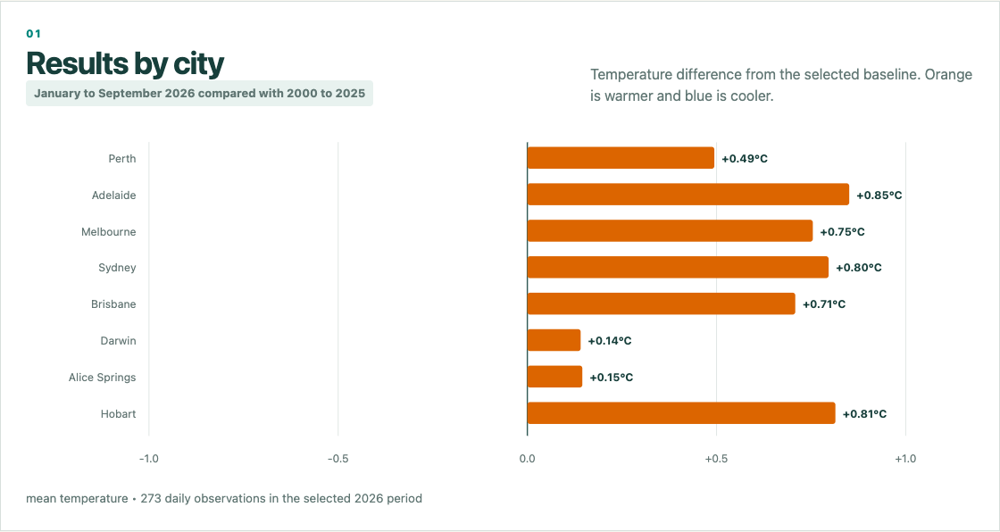
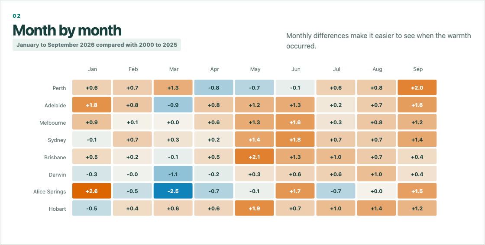
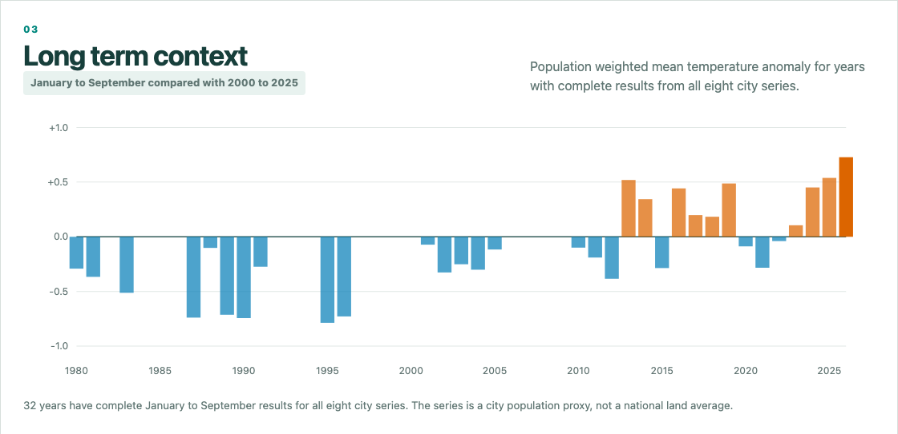

# Australian City Climate Analysis

An investigation of climate change across major Australian cities.

**The population weighted mean across eight city stations was 0.73°C above the 2000 to 2025 baseline from January to September 2026. The strongest warmth coincided with negative SOI from May, while the longer record also shows several recent warm years. This analysis does not attribute the warming to ENSO.**

Placing 2026 beside consistent historical baselines helps distinguish one unusual period from the longer temperature context facing Australian cities.

This repository generates an eight city temperature comparison, monthly heatmap and Southern Oscillation Index analysis. It also includes a small interactive browser dashboard for exploring the results.

The scripts download the required public inputs and reproduce the January to September 2026 analysis. The historical baselines are **2000–2025**, **1981–2010** and **1980–1989**, where enough reference years are available.

## Results summary

| Result | Value | Interpretation |
|---|---:|---|
| Eight city weighted mean anomaly, Jan–Sep vs 2000–2025 | **+0.728°C** | Warm relative to the recent baseline |
| Eight city weighted mean anomaly, Jan–Sep vs 1981–2010 | **+1.172°C** | Larger anomaly against the earlier baseline |
| Jan–Apr weighted anomaly vs 2000–2025 | **+0.349°C** | More modest warmth early in the year |
| May–Sep weighted anomaly vs 2000–2025 | **+1.029°C** | Stronger warmth in the middle of the year |
| Aug–Sep weighted anomaly vs 2000–2025 | **+1.021°C** | Late winter and early spring warmth remained elevated |
| Hobart Jan–Sep derived mean anomaly vs 2000–2025 | **+0.814°C** | Tmax +0.977°C; Tmin +0.647°C |
| Population represented | **18.30 million (66.3% of Australia)** | A city population proxy, not a national land average |

The 2026 monthly SOI changed sign in April and became strongly negative from May, reaching −29.1 in July and −21.4 in September. That timing is consistent with an ENSO contribution, but this descriptive analysis does not attribute the observed warmth to ENSO.







## Run the analysis

Use Python 3.11 or later. No API key is required.

```bash
python3 -m venv .venv
source .venv/bin/activate
python -m pip install -r requirements.txt
python run.py --download
```

On Windows, activate the environment with `.venv\Scripts\activate`.

No source records or machine readable derived data are included in the repository. The three documentation images are included, but the underlying records, analysis tables and dashboard result bundle are generated locally. The command downloads the documented public inputs and rebuilds every result. No API key is required.

## Open the interactive dashboard

After running `python run.py --download`, open `dashboard/index.html` directly or start a local web server from the repository folder:

```bash
python3 -m http.server 8000
```

Open [http://localhost:8000/dashboard/](http://localhost:8000/dashboard/).

The dashboard uses plain HTML, CSS and JavaScript with no build step. It includes city and monthly temperature anomalies, long term context since 1980, maximum and minimum temperature comparisons, rainfall where the record is complete, and SOI context. `build_dashboard_data.py` creates its compact result bundle from the generated CSV files, so the Python pipeline remains the single source of the calculations.

## What is included

| File or directory | Purpose |
|---|---|
| `run.py` | Runs the download, analysis and chart workflow. |
| `download_data.py` | Downloads and validates the NOAA, BoM and ABS inputs. |
| `analyze_cities.py` | Computes climatologies, anomalies and population weighted results. |
| `plot_cities.py` | Builds the static comparison chart, heatmap and SOI panel. |
| `build_dashboard_data.py` | Creates the compact browser dashboard result bundle. |
| `dashboard/` | Interactive browser dashboard for the generated results. |
| `METHODS.md` | Documents station choices, sources, calculations and limitations. |
| `tests/` | Checks the monthly coverage and published headline result. |

The `raw/`, `analysis/` and `outputs/` directories and `dashboard/results.js` are created locally and ignored by Git.

## How to interpret the results

The analysis uses one station to represent each of Perth, Adelaide, Melbourne, Sydney, Brisbane, Darwin, Alice Springs and Hobart. Archerfield is included as a Brisbane sensitivity check.

The population weighted result describes the people represented by these eight city series. It is not a national land area temperature estimate. The station records are not homogenised, so station changes, missing observations and reference year coverage remain important limitations.

The analysis describes the observed timing of temperature and SOI changes. It does not establish that ENSO caused the temperature anomalies and should not be read as an official national climate assessment. See [METHODS.md](METHODS.md) for the full calculation and data quality notes.

## Related research

- Menne et al. (2012), [An Overview of the Global Historical Climatology Network Daily Database](https://doi.org/10.1175/JTECH-D-11-00103.1), documents the station dataset used by this project.
- Trewin (2020), [An updated long term homogenized daily temperature data set for Australia](https://doi.org/10.1002/gdj3.95), explains the importance of homogenisation for Australian climate trends and helps frame this project's unhomogenised station limitation.
- Wang et al. (2023), [Health integrated heat risk assessment in Australian cities](https://doi.org/10.1016/j.eiar.2023.107176), gives wider population and urban heat context. This repository measures station anomalies only and does not estimate heat exposure or health risk.

## Data sources

- NOAA NCEI Global Historical Climatology Network Daily station records
- Bureau of Meteorology monthly Southern Oscillation Index
- Australian Bureau of Statistics city and national population estimates

Source URLs and station identifiers are documented in [METHODS.md](METHODS.md). Source data retain the terms and attribution requirements of their providers.

## Tests

```bash
python -m pip install -r requirements-dev.txt
pytest -q
```
